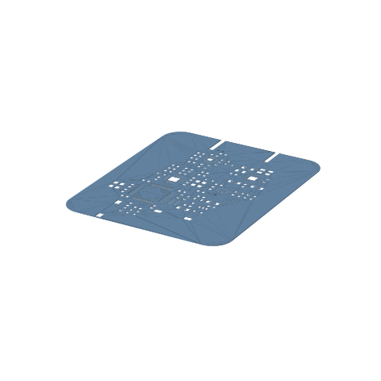
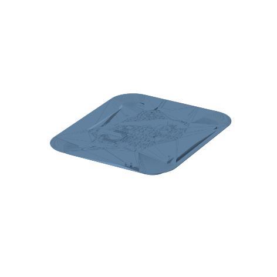
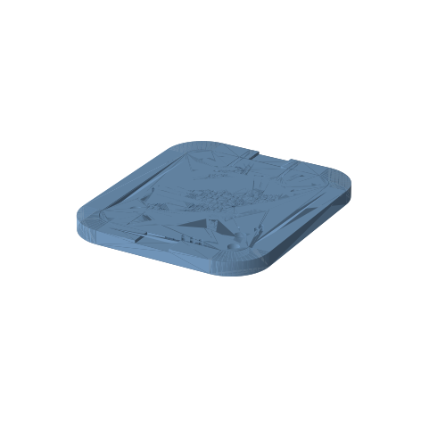

# stencilgen

Generate a **solder-paste stencil 3D model** (STEP / STL / DXF) and a **matching holder fixture**
from any EDA tool's Gerber export — in one command, fully offline.

```
board.zip  ──▶  stencil_top.step / .stl / .dxf / .svg
                stencil_bottom.step / .stl / .dxf / .svg
                fixture.step / .stl
                report.txt
```

<p align="center">
  
  
  
</p>

<p align="center"><sub>43.5 × 52.7 mm 实板：279 个开孔 / 0.12 mm 板厚 / 最小筋宽 0.199 mm + 台阶式固定底座</sub></p>

> **Why not use the PCB 3D STEP?**
> A PCB 3D export contains the board and copper, but **no paste-mask geometry**.
> Stencil apertures must come from the paste-mask layer (`GTP` / `GBP`);
> the 3D file is only good for checking board outline and thickness.

## Features

- Board outline from `BoardOutlineLayer.GKO` / `Edge_Cuts` (segments are stitched into a closed loop)
- 279 apertures, 0.2 mm webs — the real thing, straight from your Gerber
- Stepped fixture: PCB drops into the lower pocket, stencil sits on the PCB, walls register both
- Report: aperture count, paste area, minimum web, **apertures that fall outside the board**
- STEP is compact (~6 MB) — surface curves are skipped

## Requirements

- Python 3.9+ (3.11 tested)
- `cadquery-ocp` — the OpenCASCADE kernel (wheels exist for **Windows / macOS / Linux**)
- `numpy`
- optional: `ezdxf` for DXF output, `tkinterdnd2` for drag & drop in the GUI
- Linux GUI only: `sudo apt install python3-tk` (plus a CJK font if you want the Chinese labels)

## Install

```bash
git clone https://github.com/H-h-Hh/stencilgen.git
cd stencilgen
pip install -e ".[dxf]"
```

## UI language

The GUI follows the system language — Chinese on a Chinese system, English otherwise.
Force it with an environment variable:

```bash
STENCILGEN_LANG=en stencilgen          # macOS / Linux
set STENCILGEN_LANG=en && stencilgen   # Windows cmd
```

Linux needs a CJK font for the Chinese UI (`fonts-wqy-zenhei` or similar).

## Use

```bash
# GUI
stencilgen

# one board, both sides + fixture
stencilgen board.zip --fixture --board-thickness 1.586

# thinner paste, 5 mm border around the board, custom output
stencilgen board.zip -t 0.10 -m 5 -o ./out --fixture --fixture-border 8
```

macOS / Linux without installing: `./run.sh board.zip --fixture`

| option | default | |
|---|---|---|
| `-t, --thick` | 0.12 | stencil thickness (mm) |
| `-m, --margin` | 0 | border around the board outline (mm) |
| `-o, --out` | `<board>_stencil` | output folder |
| `--board-thickness` | 1.6 | PCB thickness, used by the fixture |
| `--fixture` | off | also build the holder frame |
| `--fixture-border` | 6 | frame width (mm) |
| `--fixture-height` | 4.0 | frame height (mm) |
| `--board-clearance` | 0.15 | PCB pocket clearance per side |
| `--stencil-clearance` | 0.10 | stencil pocket clearance per side |

## Supported input

Any EDA tool that exports **RS-274X (Gerber)** with a paste-mask layer.
Tested against real board exports and against KiCad-style files
(X2 attributes, `F_Paste.gtp` / `Edge_Cuts.gm1`, custom aperture macros).

| what | how it is handled |
|---|---|
| layer role | Gerber X2 `%TF.FileFunction%` first, file name as fallback |
| file names | `*.GTP/GBP/GKO`, `F_Paste.gtp`, `B_Paste.gbp`, `Edge_Cuts.gm1`, or any name at all if X2 attributes are present |
| units | mm and inch |
| apertures | `C` circle, `R` rect, `O` obround, `P` polygon |
| aperture macros | primitives 1 (circle), 20 (vector line), 21 (center line), 4 (outline), 5 (polygon); 6/7 approximated |
| board outline | stroked segments (stitched into closed loops) or a `G36` region |

Limitations: macro primitives with exposure `0` (clear) are treated as dark, and a
`G36` region containing holes is cut as separate solids. Neither shows up in paste
layers in practice, but check the output if your tool does something exotic.

## Tests

```bash
python -m unittest discover -s tests -v
```

`tests/fixtures/` holds a small synthetic Gerber set (X2 attributes, a custom
aperture macro, an obround, an odd file name) that pins down the parser and the
macro interpreter — no CAD kernel involved in those cases.

## Windows portable build

`build_exe.bat` produces a self-contained 335 MB folder (`StencilGen-免安装版`)
that runs **without Python** on the target machine. It needs one network round
to fetch PyInstaller the first time.

For macOS / Linux, either `pip install` (recommended) or build with PyInstaller —
see `.github/workflows/build.yml` for a three-platform recipe.

### "PermissionError: [WinError 5]" when writing output

If the folder lives under a directory that carries a **low-integrity label**
(virtualisation and sandboxing tools label their working directories this way),
every executable inside inherits that label and the app gets *access denied* on
any write outside the sandbox — while the same folder copied elsewhere works
fine. Confirm with `icacls`:

```bat
icacls StencilGen.exe /setintegritylevel Medium
```

`launcher.txt` / `启动.bat` runs exactly this before starting the app, and
`build_exe.bat` re-labels its output, so a plain double-click on the launcher
self-heals. Starting `StencilGen.exe` directly does not.

## 中文速览

```bash
pip install -e ".[dxf]"
stencilgen 板子.zip --fixture --board-thickness 1.586
```

- 钢网开孔取自 **钢网层（Paste Mask）**，板框取自 `BoardOutline` 层
- 底座是台阶式卡槽：PCB 沉底、钢网叠在 PCB 上表面，四周槽壁定位
- 加边（`-m`）会同时放大底座，钢网槽跟随钢网真实外形
- Windows 免安装版见 `build_exe.bat`

## License

MIT — see [LICENSE](LICENSE).
